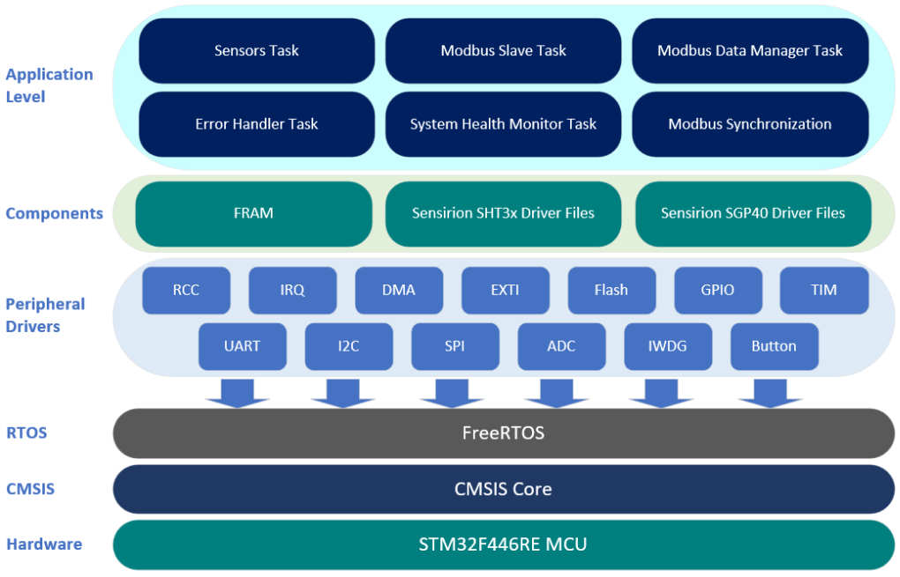
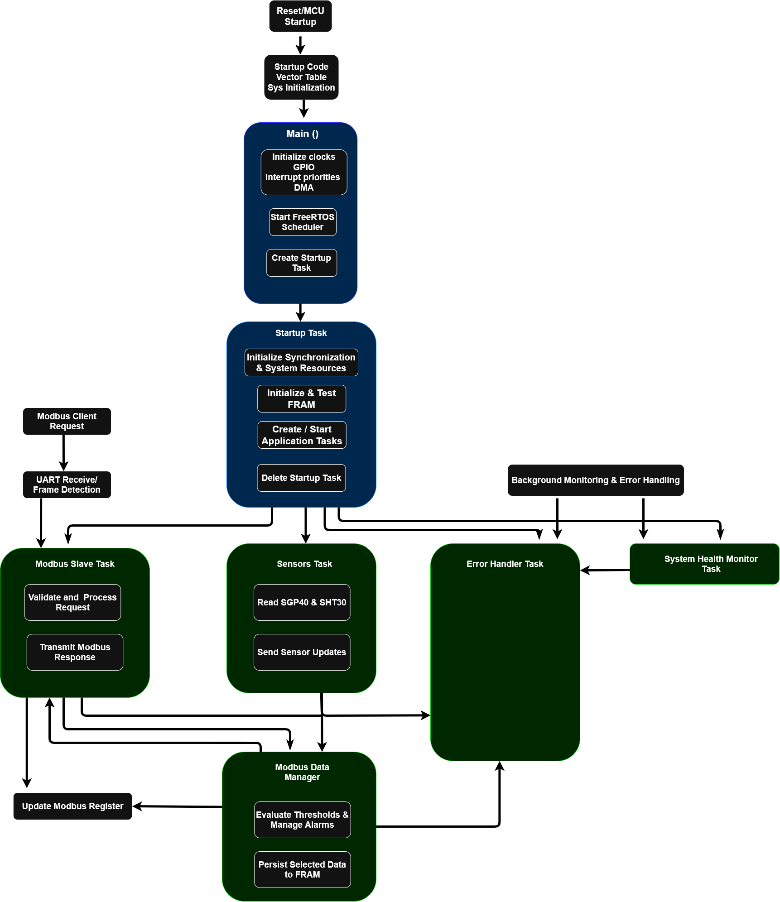
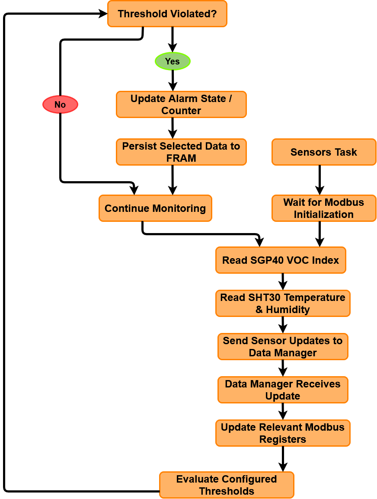
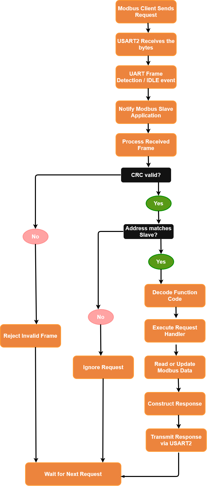
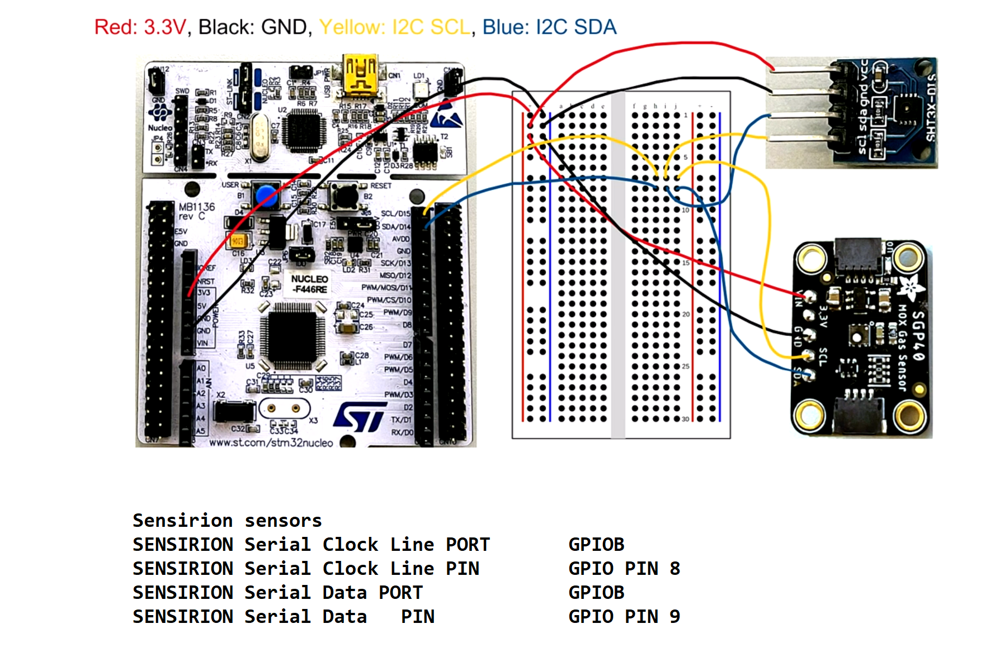
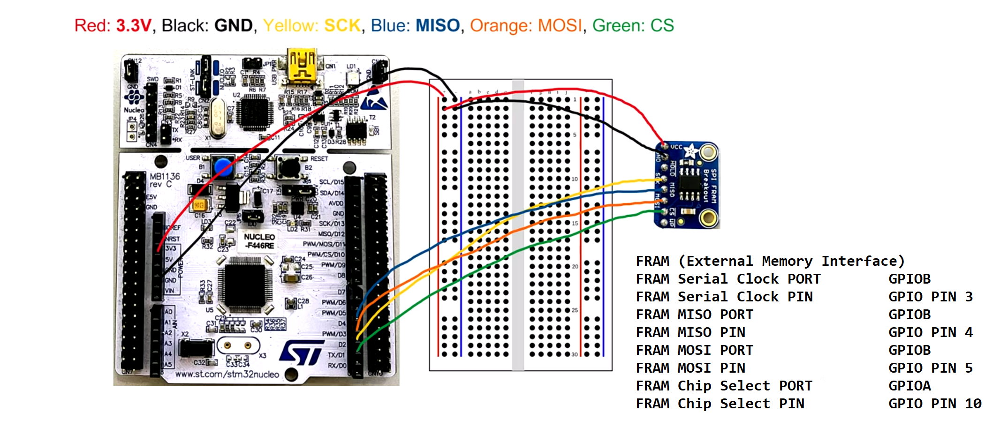

# STM32F446RE Indoor Air Quality Monitoring System

A register-level embedded firmware project built around the **STM32F446RE**, combining **CMSIS, FreeRTOS, environmental sensors, SPI FRAM, and a custom Modbus RTU slave**.

The project implements low-level peripheral development, real-time task coordination, sensor integration, non-volatile storage, and modular communication protocol design.

## Overview

The firmware acquires a VOC index from an SGP40 sensor and temperature and relative humidity from an SHT3x sensor. Sensor measurements are passed to the Modbus data manager, which updates the relevant registers and evaluates configured alarm thresholds. Selected configuration and application data are persisted in FRAM.

The project works as a reference implementation, with an emphasis on code structure, modularity, and maintainability.

## Key Features

- **CMSIS/register-level development** for the STM32F446RE.
- **FreeRTOS task architecture** for sensor acquisition, Modbus communication, data management, error handling, and system health monitoring.
- **Task synchronization** using FreeRTOS communication and synchronization primitives.
- **Environmental sensing** with the SGP40 VOC sensor and SHT3x temperature/humidity sensor.
- **Modbus RTU slave** with UART reception, frame detection, CRC validation, request processing, register access, and response transmission.
- **SPI FRAM storage** for selected configuration and application data.
- **Threshold-based alarms** with state and counter updates.
- **Modular peripheral drivers** for the project's MCU interfaces and supporting hardware.

## System Architecture

  

The firmware is organized into application tasks, sensor and FRAM components, peripheral drivers, FreeRTOS, CMSIS, and the STM32F446RE hardware layer.

## Firmware Execution Flow

  

At startup, the MCU initializes system-level resources and starts the FreeRTOS scheduler. The Startup Task initializes synchronization resources and FRAM, starts the application tasks, and then deletes itself. The runtime tasks subsequently handle sensor acquisition, Modbus requests, data management, error handling, and system health monitoring.

## Sensor Acquisition and Data Management

  

The Sensors Task waits for Modbus initialization, reads the SGP40 VOC index and SHT3x temperature/humidity values, and sends successful measurements to the Modbus Data Manager. The Data Manager updates the relevant registers, evaluates configured thresholds, updates alarm state/counters, and persists selected data.

## Modbus RTU Request Flow

  

The Modbus slave receives requests through USART2, detects the end of a received frame, validates the frame, checks the slave address, processes supported function codes, accesses the relevant Modbus data, and transmits a response when appropriate.

## Hardware

| Component | Role |
|---|---|
| STM32 Nucleo-F446RE | Main microcontroller development board |
| SGP40 | VOC index measurement |
| SHT3x | Temperature and relative humidity measurement |
| SPI FRAM module | Non-volatile storage |
| Host PC and Modbus client software | Register and alarm testing |

### Circuit Setup

  

  

## Modbus Testing

The firmware was tested using Simply Modbus software to inspect register values and exercise sensor and alarm behavior.

  

  

The documented tests demonstrate sensor values being reflected in input registers, configuration values in holding registers, and alarm behavior changing in response to monitored values.

## Software Stack

- **Language:** C
- **IDE:** STM32CubeIDE
- **MCU interface:** CMSIS and STM32F4 device definitions
- **RTOS:** FreeRTOS
- **Sensors:** Sensirion SGP40 and SHT3x drivers
- **Non-volatile storage:** SPI FRAM
- **Communication:** Modbus RTU over USART2

## Technical Documentation

The project document contains the detailed architecture, task responsibilities, circuit photographs and pin mappings, Modbus request processing, and test evidence.
The attached images can be found in full resolution in the Docs/Images

**[Technical documentation (PDF)](Docs/STM32F446RE-Indoor-Air-Quality-Project.pdf)**

## Potential Future Development

Further Improvements include historical environmental data logging, expanded remote diagnostics, and characterization of task timing and communication latency.
